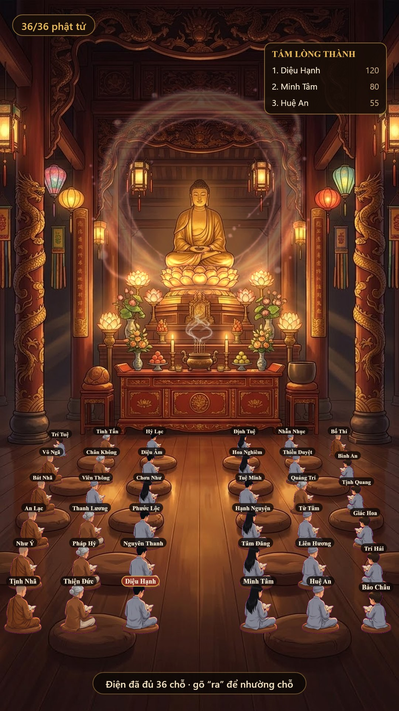

# Chánh Điện Tịnh Tâm — bản port cho bot Zalo

Port game web [chanh-dien-online-bear](https://github.com/khanhdevngu/chanh-dien-online-bear) (MIT, fork của `kentjuno/chanh-dien-online`) sang bot Zalo chạy trên framework **zlbotnta**.

Cả nhóm cùng ngồi trong **một** chánh điện 36 chỗ. Ai gõ `tham gia` thì được xếp vào nệm trống, sau đó gõ thẳng không cần prefix: tụng kinh, dâng lễ, xem công đức, đổi áo, ra về.



## Tính năng

| Nhóm | Nội dung |
|---|---|
| Vào/ra | `tham gia` (hoặc `vào`, `ngồi`, `an tọa`), `ra` (nhường chỗ) |
| Tu tập | `tụng kinh` — niệm một câu kinh ngẫu nhiên |
| Dâng lễ | `1` cánh sen (+1) · `2` dâng hương (+5) · `3` hoa sen (+20) · `4` thỉnh chuông (+99) |
| Lời nguyện | `dâng hương cầu cho mẹ khỏe` → ghi kèm lời nguyện vào caption |
| Xem | `công đức` (top 3 trong điện) · `ds` (ai đang ngồi) · `help` |
| Ngoại hình | `đổi áo nam\|nữ\|bà\|ni\|sư\|trẻ` |
| Quản trị | `#chanhdien on\|off\|reset\|check` · `#chanhdien top` (bảng công đức toàn bot) |

Điện đủ 36 người thì báo kín chỗ; ai ngồi **45 phút** không tương tác sẽ tự nhường chỗ, điện vắng **60 phút** thì tự đóng.

## Điểm kỹ thuật đáng chú ý

**Ảnh vẽ lại theo nhịp gộp (debounce 1.2s).** 20 người dâng lễ cùng lúc chỉ tốn **một** ảnh, caption lấy sự kiện cuối — không spam nhóm.

**Chất lượng ảnh.** Ảnh vẽ 1:1 ở 1080×1920, không scale, không supersample, xuất JPEG chất lượng cao và chỉ hạ dần khi vượt 480 KB (ngưỡng Zalo bắt đầu nén lại). Có một cái bẫy đã fix:

```js
// @napi-rs/canvas CHỈ đọc quality khi truyền SỐ NGUYÊN 0..100
canvas.toBuffer("image/jpeg", 0.9);            // ❌ hiểu là thang 0..100 -> ~0 -> nén nát, mờ
canvas.toBuffer("image/jpeg", { quality: 0.9 }); // ❌ BỎ QUA quality, luôn ~90 cố định
canvas.toBuffer("image/jpeg", 92);             // ✅ đúng ý
```

`encodeJpeg()` tự chọn đúng thang theo thư viện (napi-rs: 0–100, node-canvas: 0–1).

**Font tiếng Việt.** `"Noto Serif"` không có trên Windows và font thay thế thiếu glyph — `Hỷ` thành `H□`. Dùng `"Times New Roman", "Cambria", Georgia, serif`.

**Hàng ghế đo theo ảnh nền.** Toạ độ 6 hàng nệm được đo trực tiếp trên `hall.jpg` của repo này (`ROW_Y`), nên người ngồi đúng trên nệm chứ không lơ lửng.

## Cấu trúc

```
src/service-dqt/game-service/chanh-dien/chanh-dien.js   # logic game (state, action, render)
src/utils/canvas/canvas-chanh-dien.js                   # vẽ chánh điện ra JPEG
assets/chanh-dien/                                      # hall.jpg + sprite + fx
docs/preview-*.jpg                                      # ảnh xem trước
INSTALL.md                                              # 4 bước gắn vào bot
```

## Cài vào bot

Xem [INSTALL.md](INSTALL.md) — chỉ 4 chỗ cần sửa.

## Ghi công

- Game gốc: [khanhdevngu/chanh-dien-online-bear](https://github.com/khanhdevngu/chanh-dien-online-bear) — Bear, fork từ `kentjuno/chanh-dien-online`.
- Hình nền, sprite, hiệu ứng: lấy từ repo gốc, giấy phép MIT.
- Bản port Zalo: viết lại toàn bộ phần logic/UI cho môi trường chat.

## Giấy phép

MIT — xem [LICENSE](LICENSE).
