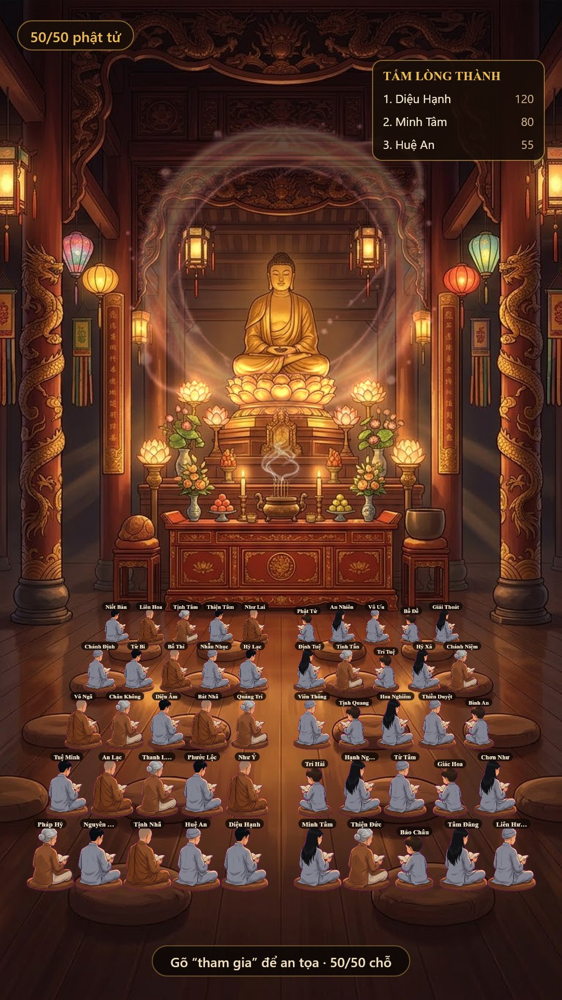
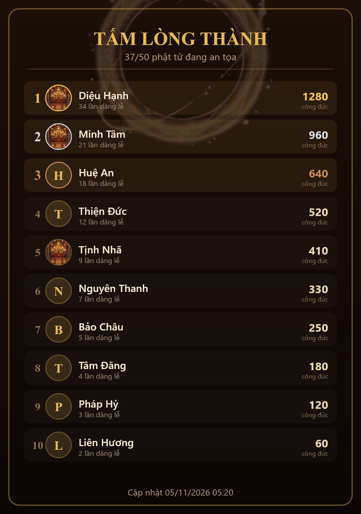

# Chánh Điện Tịnh Tâm — bản port cho bot Zalo

Port game web [chanh-dien-online-bear](https://github.com/khanhdevngu/chanh-dien-online-bear) (MIT, fork của `kentjuno/chanh-dien-online`) sang bot Zalo chạy trên framework **zlbotnta**.

**Một chánh điện chung 50 chỗ cho toàn server.** Mọi nhóm của mọi bot (bot chính + bot con + bot phụ) cùng nhìn một điện, cùng ngồi chung, công đức cộng dồn một bảng.



## Ba cách vào điện

| Cách | Ghi chú |
|---|---|
| `#chua` | vào ngay, không cần bật gì trước |
| gõ thẳng `tham gia` | không cần prefix |
| thả ❤️ vào ảnh điện | giống masoi thả tim vào sảnh — chỉ cần 1 cú chạm |

Người vào bằng cách nào cũng hiện lên **cùng một chỗ**, đồng bộ tức thì.

## Trong điện (gõ thẳng, không cần prefix)

`ra` · `tụng kinh` · `1` cánh sen (+1) · `2` dâng hương (+5) · `3` hoa sen (+20) · `4` thỉnh chuông (+99) · `công đức` · `ds` · `đổi áo nam|nữ|bà|ni|sư|trẻ`

Ghi lời nguyện: `dâng hương cầu cho mẹ khỏe`.

## Lệnh quản trị (quản trị bot)

```
#chua on                 bật chánh điện toàn server (mọi bot)
#chua off                tắt toàn server (kèm tắt gửi định kỳ)
#chua pr on              gửi ảnh điện hiện tại cho TOÀN BỘ nhóm, và lặp lại định kỳ
#chua pr off             ngừng gửi định kỳ
#chua pr time 30s|15p|1h đổi chu kỳ (mặc định 3 giờ, sàn 10 giây, trần 24 giờ)
#chua pr                 xem trạng thái gửi
#chua top                ảnh bảng công đức kèm avatar
#chua status | help
#chua check | reset      kiểm tra tài nguyên / dọn điện
```

## Bảng công đức có avatar

`#chua top` vẽ hẳn một ảnh: hạng, avatar tròn, tên, số lần dâng lễ, tổng công đức.



Avatar lấy theo thứ tự: file có sẵn trong `assets/user-thumb/<uid>.<png|jpg|webp>` → nếu chưa có thì tải từ Zalo (`getInfoMembers`) và cache lại. Không lấy được thì vẽ chữ cái đầu.

## Điểm kỹ thuật

**Broadcast có chống spam.** `#chua pr on` gửi ảnh cho mọi nhóm của mọi bot, giãn nhịp 250ms mỗi nhóm. Khi có người thả ❤️ hoặc gõ `tham gia`, ảnh được đồng bộ lại toàn bộ nhóm nhưng **gộp 20 giây** và **không dày hơn 1 phút/lần** — 50 người vào liên tiếp vẫn chỉ tốn 1 lượt gửi.

**Ảnh vẽ 1:1 ở 1080×1920**, không scale, không supersample; JPEG chất lượng cao, chỉ hạ dần khi vượt 480 KB (ngưỡng Zalo bắt đầu nén lại).

```js
// @napi-rs/canvas CHỈ đọc quality khi truyền SỐ NGUYÊN 0..100
canvas.toBuffer("image/jpeg", 0.9);              // ❌ hiểu là thang 0..100 -> ~0 -> nén nát, mờ
canvas.toBuffer("image/jpeg", { quality: 0.9 }); // ❌ BỎ QUA quality, luôn ~90 cố định
canvas.toBuffer("image/jpeg", 92);               // ✅ đúng ý
```

`encodeJpeg()` tự chọn đúng thang theo thư viện (napi-rs: 0–100, node-canvas: 0–1).

**Font tiếng Việt.** `"Noto Serif"` không có trên Windows và font thay thế thiếu glyph — `Hỷ` thành `H□`. Dùng `"Times New Roman", "Cambria", Georgia, serif`.

**Hàng ghế đo theo ảnh nền.** `ROW_Y` lấy trực tiếp từ `hall.jpg` (5 hàng nệm thật), nên người ngồi đúng trên nệm chứ không lơ lửng.

## Cấu trúc

```
src/service-dqt/game-service/chanh-dien/chanh-dien.js   # logic (state chung, broadcast, action)
src/utils/canvas/canvas-chanh-dien.js                   # vẽ điện + bảng công đức
assets/chanh-dien/                                      # hall.jpg + sprite + fx
docs/preview-*.jpg
INSTALL.md                                              # 4 bước gắn vào bot
```

## Cài vào bot

Xem [INSTALL.md](INSTALL.md).

## Ghi công

- Game gốc: [khanhdevngu/chanh-dien-online-bear](https://github.com/khanhdevngu/chanh-dien-online-bear) — Bear, fork từ `kentjuno/chanh-dien-online`.
- Hình nền, sprite, hiệu ứng: lấy từ repo gốc, giấy phép MIT.
- Bản port Zalo: viết lại toàn bộ phần logic/UI cho môi trường chat.

## Giấy phép

MIT — xem [LICENSE](LICENSE).
